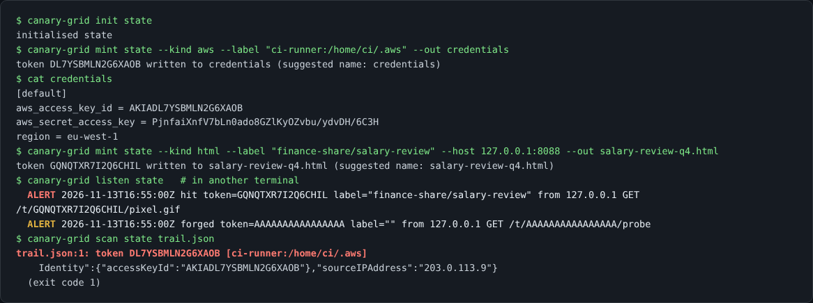

# canary-grid

Most breaches are noticed months late. A **honeytoken** is a fake credential or document that no legitimate person ever touches, so the first time anything uses it you have a high-confidence alert with no tuning. **canary-grid** is a small self-hosted version: mint signed decoys, plant them where an intruder would look, catch the first touch with a tiny listener, and search logs for tokens that leaked.

Rust, zero dependencies, about 1,600 lines including tests. No SaaS, no account, no phone-home.



## How it works

1. `mint` creates a decoy file and registers it with a label saying **where you planted it** (`ci-runner:/home/ci/.aws`). When it fires, the label tells you which system was compromised.
2. `listen` is an HTTP endpoint. Any request whose path carries a valid token is logged to `hits.jsonl` and printed as an `ALERT` line.
3. `scan` searches files for tokens. A decoy AWS key that appears in a CloudTrail export, a proxy log, shell history or a git checkout has been copied or used, and this works even though AWS itself rejects the key.

| Kind | Decoy | Fires when |
|---|---|---|
| `aws` | `~/.aws/credentials` with a key id shaped like `AKIA...` | the key id shows up in a log you `scan` |
| `env` | `.env.production` with the same key plus decoy API URLs | the URLs are requested, or the key is found in logs |
| `kube` | a kubeconfig pointing at the listener | `kubectl` or a scanner contacts the server URL |
| `html` | a "salary review" page with a lure link and a 1x1 beacon | the page is opened with network access, or the link is followed |
| `url` | a bare URL to paste into a wiki or a database row | it is requested |

## Tokens are signed

A token is 16 base32 characters: 5 random bytes plus a 5 byte HMAC-SHA-256 over them, keyed with a secret that never leaves the state directory. Two consequences:

- `scan` recognises **our** tokens from the text alone, so random 16-letter strings in your logs do not match.
- The listener tells apart a genuine hit (`hit`), a hit from a token we minted but lost track of (`hit-unregistered`), and someone guessing or tampering (`forged`, which is itself a useful signal that something is probing).

## Usage

```bash
cargo build --release
canary-grid init state
canary-grid mint state --kind aws  --label "ci-runner:/home/ci/.aws" --out credentials
canary-grid mint state --kind html --label "finance-share/salary-review" --host canary.example.org:8088 --out review.html
canary-grid listen state --bind 0.0.0.0:8088      # put it behind your normal reverse proxy / firewall rules
canary-grid hits state                            # read the log
canary-grid scan state cloudtrail.json proxy.log ~/.bash_history   # exit 1 if any token is found
tail -f state/hits.jsonl | your-alerting-pipeline
```

`--trust-proxy` makes the listener record the first `X-Forwarded-For` address as the source, for use behind a reverse proxy you control. Leave it off otherwise, since the header is attacker-controlled.

## Listener hardening

It is a honeypot endpoint exposed to hostile traffic, so it is deliberately boring:

- Reads at most 16 KiB of headers with a 5 second timeout; oversize gets `431`, garbage gets `400`.
- At most 64 concurrent connections; excess connections are dropped.
- At most 60 logged hits per source address per minute, so a flood cannot fill the disk.
- Logged fields are control-character stripped and length capped, and the log is JSON lines written under a lock, so request content cannot forge or split log entries.
- It never proxies, never reflects request content in a response, and returns a fixed body.
- Unrelated paths get `404` and are not logged, so scanners hitting `/` do not drown the real signal.
- The signing key is created with mode `0600`, `init` refuses to overwrite it, and the `Store` type redacts the key from debug output.

## Limits

- Decoys are only as good as their placement. A token nobody can reach never fires, and a token in an obvious place may be recognised and avoided.
- An AWS decoy key is **detected through your logs**, not by AWS. CloudTrail does record attempts with unknown key ids, but you have to export and `scan` them (or scan a SIEM export). For instant AWS-side alerts use a real account-level canary service.
- Plain HTTP only. Put a TLS-terminating proxy in front if you want `https` lures.
- Unix only (it reads `/dev/urandom` and sets file modes).
- Defensive use only: plant decoys on systems you own or are authorised to defend.

## Layout

```text
src/hash.rs     SHA-256, HMAC, base32, hex (RFC test vectors in the tests)
src/token.rs    mint, verify, find tokens in text
src/decoy.rs    the five decoy kinds
src/store.rs    state directory: key, registry, hit log
src/listen.rs   the HTTP listener
src/scan.rs     file scanner
tests/          live listener tests (real sockets) and the CLI workflow
```

MIT licensed.
